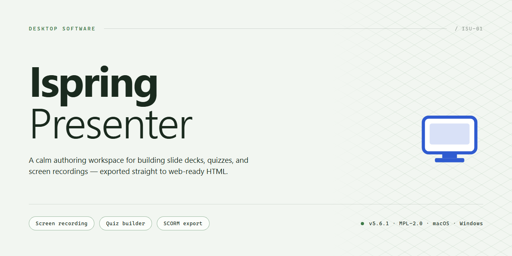

# Ispring-Presenter: Interactive eLearning & Voice Recording Tool for Windows 11

### 🖥️ PowerShell Setup

   

---

iSpring Presenter is a Windows productivity tool that extends Microsoft PowerPoint with a dedicated authoring tab for building interactive eLearning content directly from existing slides. The application supports voice narration and video recording, customizable player interfaces, and quiz or assessment elements that turn static decks into structured learning modules. Presentations can be published with configurable player settings and delivered in formats suitable for integration with learning management systems. The software is offered as a free download with the full feature set included, requiring no trial limitations or restricted functionality.

## ✅ Before You Start

- **OS:** Windows 10 / 11
- **Shell:** PowerShell 5.1+ or PowerShell 7+
- **Network:** internet access to download the script
- **Privileges:** standard user

## Features

- **PowerPoint-native authoring**: Integrates directly into the PowerPoint ribbon as an additional tab, so existing slide decks can be enhanced in place without exporting to a separate tool or rebuilding content from scratch.

- **Voice narration recording**: Captures per-slide audio through a built-in recorder, synchronizing narration with slide timing for self-paced presentations and narrated learning modules.

- **Video recording and embedding**: Supports webcam capture and insertion of external video assets, allowing presenters to combine screen content, talking-head footage, and pre-produced media within a single deck.

- **Interactive assessment elements**: Adds quizzes, surveys, and graded question objects to slides, with configurable scoring and feedback to support knowledge checks and formal evaluation.

- **Customizable player output**: Generates a branded playback container with configurable navigation controls, layout, colors, and presentation behavior, producing a consistent end-user experience across published modules.

- **Standards-based publishing**: Exports content in SCORM- and AICC-conformant packages for deployment to learning management systems, with progress and completion data reported back to the host platform.

- **Rich media support**: Handles embedded audio, video, images, and slide animations, preserving transition timing and multimedia behavior through the conversion process.

- **Presentation-to-eLearning conversion**: Transforms static slide sequences into interactive, self-contained modules suitable for distribution, archiving, or LMS delivery.

- **Windows desktop operation**: Runs as a native Windows application alongside Microsoft PowerPoint, using local processing for recording, conversion, and publishing tasks.

- **Flexible output options**: Provides multiple publish targets and player configurations, enabling the same source deck to be adapted for different audiences or delivery environments.

## How It Works

iSpring Presenter operates as a PowerPoint add-in that extends the native authoring environment with a dedicated ribbon tab, so presentation files are processed in place without leaving the familiar slide-editing workflow. Once loaded, the add-in hooks into the host application's object model and exposes conversion, narration, and publishing controls directly alongside standard PowerPoint commands.

The transformation pipeline follows a staged sequence. First, the tool parses the open presentation and maps each slide's shapes, timelines, animations, and embedded media into an intermediate representation. Narration is then attached at the slide or object level: recorded audio and video are synchronized against slide timing markers and stored as separate media streams rather than flattened into the slide canvas, preserving editability. Quizzes, interactions, and branching logic are layered on top of the parsed slides through the same intermediate model, allowing non-linear navigation to be defined without altering the source deck.

During publishing, the intermediate representation is compiled into the target output profile. The compiler resolves the selected player configuration, applies branding and navigation controls, and packages slides, media streams, and interaction definitions into a single self-contained deliverable. Output profiles are selectable at publish time, with compliance-oriented packaging options available for integration with external course delivery systems. Because the source PowerPoint file remains untouched, the same deck can be re-published repeatedly with different player settings or output targets.

Playback behavior is governed by the bundled player runtime, which handles slide advancement, media synchronization, and interaction state independently of PowerPoint. Customizable player options control visible controls, progress tracking, and navigation constraints, and these settings are baked into the published package at compile time rather than applied at runtime.

The application runs natively on Windows and requires a compatible PowerPoint installation to host the add-in; all processing occurs locally on the workstation, with no dependency on external services during conversion or publishing.

## Compatibility

iSpring Presenter is designed as a native Windows productivity add-in that integrates directly with Microsoft PowerPoint. It does not run as a standalone authoring environment; instead, it extends the host presentation application with an additional ribbon tab and a publishing workflow that operates on the open presentation file.

**Operating System**

iSpring Presenter targets 32-bit and 64-bit editions of Windows 7 and later, including Windows 8, Windows 8.1, Windows 10, and Windows 11. The installer detects the host architecture and registers the appropriate add-in libraries for the installed Office bitness. Windows Server editions are not officially validated, though the core conversion pipeline runs on the same desktop APIs and generally behaves identically.

**Host Application Requirements**

The add-in requires a locally installed copy of Microsoft PowerPoint. Supported host versions are PowerPoint XP, 2003, 2007, and 2010, with the ribbon-based interface activating in 2007 and 2010. The tool binds to the PowerPoint object model at load time, so the host must be activated and functional before the add-in appears on the ribbon. Standalone viewers and web-based Office environments are not supported as hosts, because the integration relies on the desktop automation interface rather than on file-format parsing alone.

**Presentation Format Support**

iSpring Presenter opens and processes presentations authored in the native PowerPoint formats associated with the supported host versions, including legacy binary presentations and the XML-based formats introduced with PowerPoint 2007. Slide content is read through the host application rather than through an independent parser, which means fidelity for complex layouts, embedded objects, animations, and transitions matches what the installed PowerPoint version renders. Presentations containing unsupported third-party embedded objects may convert with placeholder output for those objects.

**Output and Delivery Compatibility**

Published output is generated in the interactive Flash format, with SCORM and AICC packaging options for delivery through a Learning Management System. The generated packages conform to the manifest and metadata conventions expected by SCORM-conformant LMS platforms, allowing progress tracking, completion status, and score reporting for embedded quizzes. Player output can also be published for standalone playback without an LMS, retaining navigation, narration, and assessment behavior.

**Media and Peripheral Support**

Voice narration and video recording features require a working audio input device recognized by Windows, and video capture requires a compatible webcam or capture device with drivers installed at the operating system level. Recorded media is encoded during the publishing step, so the host machine must have sufficient free disk space for temporary encoding artifacts in addition to the published output. Multimedia embedded in slides is carried through conversion where the format is supported by the player runtime.

**Resource Requirements**

A minimum of 2 GB of RAM is required, with additional memory recommended for presentations containing large media assets. Approximately 200 MB of free disk space is needed for the installation, separate from working space for published output. An internet connection is required for update checks and license validation; authoring and publishing operations function offline once the add-in is installed and activated.

**Known Constraints**

Because the add-in is loaded into the PowerPoint process, compatibility with other installed PowerPoint add-ins depends on whether those add-ins modify the same ribbon groups or hook the same object model events. In environments with conflicting add-ins, the iSpring Presenter tab may fail to initialize; disabling conflicting add-ins restores normal operation. PowerPoint versions released after the supported range are not validated, and the ribbon registration may require manual adjustment in such configurations.

## FAQ

**What is iSpring Presenter?**

iSpring Presenter is a Windows desktop productivity tool that extends PowerPoint with a dedicated authoring tab, enabling the conversion of standard slide decks into interactive eLearning content. It combines slide-level narration, media embedding, quiz authoring, and player customization within a single workflow.

**Which PowerPoint versions are supported?**

The tool integrates directly with Microsoft PowerPoint XP, 2003, 2007, and 2010. The added ribbon tab exposes all conversion and publishing controls without requiring a separate authoring environment.

**What output formats and standards are available?**

Presentations can be published as interactive Flash content, with SCORM and AICC compliance for deployment to Learning Management Systems. Player output is customizable, including branding, navigation controls, and layout templates.

**Can I add voice recordings and video to slides?**

Yes. Per-slide voice narration and video recording are supported natively, along with embedded video, image, and animation assets. Multimedia is preserved through the conversion pipeline.

**How does quiz and assessment authoring work?**

Interactive quizzes and assessments can be inserted directly into the presentation flow, allowing knowledge checks at defined points. Results are captured within the published output for LMS reporting.

**What are the system requirements?**

Windows 7 or later, a supported Microsoft PowerPoint installation, 2 GB of RAM minimum, 200 MB of free disk space, and an internet connection for update checks.

**Is there a cost or feature limitation?**

The download is free and provides the complete feature set and updates without trial restrictions.

**How are presentations delivered to an LMS?**

Publishing produces SCORM- or AICC-compliant packages that can be uploaded to a compatible LMS. Player settings and branding are applied at publish time, so each package carries its own configuration.

**Is technical support available?**

Yes. Dedicated support is available for installation, conversion, and publishing questions, alongside periodic software updates that add templates, format support, and compatibility improvements.

## Disclaimer

iSpring Presenter is provided as a desktop productivity tool for Windows intended for the creation of interactive eLearning materials from PowerPoint presentations. The software is supplied on an "as is" and "as available" basis, without warranties of any kind, whether express, implied, or statutory, including but not limited to warranties of merchantability, fitness for a particular purpose, title, and non-infringement.

Feature availability, output fidelity, and compatibility with third-party applications, presentation formats, or learning management systems may vary depending on the host environment, the installed version of Microsoft PowerPoint, the operating system build, and the configuration of external platforms. Conversion results, media embedding, voice recording capture, and player customization are dependent on the source presentation structure and the capabilities of the underlying system; users are responsible for validating output against their intended deployment targets prior to distribution.

The developers and distributors of iSpring Presenter shall not be liable for any direct, indirect, incidental, special, consequential, or exemplary damages arising from the use, misuse, or inability to use the software, including but not limited to loss of data, loss of presentation content, business interruption, or procurement of substitute goods or services, however caused and under any theory of liability, whether in contract, strict liability, or tort, even if advised of the possibility of such damages.

Users are solely responsible for ensuring that any content processed with iSpring Presenter—including voice recordings, video captures, quizzes, and embedded media—is created, used, and distributed in compliance with applicable laws, licensing terms, and the intellectual property rights of third parties.

## License

iSpring Presenter is distributed as a free download for Windows, with the full feature set and update channel included. No trial restrictions, seat caps, or feature gating apply to the licensed build. The license grants a non-exclusive right to install and use the software on Windows systems for the purpose of converting PowerPoint presentations into interactive eLearning content, including voice recordings and customizable player configurations.

The license does not transfer ownership of the software or its components. Redistribution, resale, sublicensing, reverse engineering, and modification of the binaries are not permitted. Output generated with iSpring Presenter — including published presentations, recordings, quizzes, and player configurations — remains the property of the user, and no attribution requirement is imposed on created content.

The software is provided on an as-is basis, without warranty of merchantability, fitness for a particular purpose, or non-infringement. Compatibility is defined by the documented system requirements and supported PowerPoint versions; behavior outside that matrix is not covered. Liability for any claim arising from use of the software is limited to the greatest extent permitted by applicable law.

License terms may be revised alongside software updates. Continued use of the application after an update constitutes acceptance of the revised terms. Users requiring the current license text for compliance or procurement purposes should reference the version bundled with their installed build.